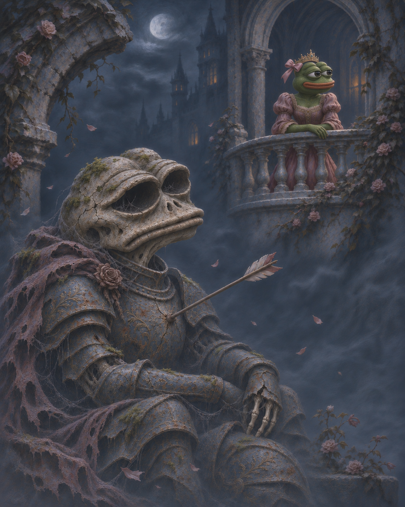

# Its over

> it may be over now, but for a brief moment in time, we were so back

A browser platformer about working up the courage to say something, getting carried away by a daydream, and dealing with heartbreak. Featuring Pepe, Pink Pepe, some extremely unhelpful geese, and a cabin at the end of a very long day.

<p align="center"></p>

## The game

Three chapters: **City Lights**, **The Garden**, and **Awake**. The city is about getting ready to approach someone. The garden is the date you imagine. The jungle is the walk back to reality.

- **Story Mode:** play the chapters in order. Reaching the end of the city and accepting the invitation opens the garden; the diner leads into the final chapter.
- **Level Select:** all three chapters are available immediately for practice.
- **Endless Mode:** choose the city, garden, or jungle, then play as either character on a generated route. Each world has its own enemies, soundtrack, and best scores.
- **Easy / Hard:** three hearts or one heart. Choose before starting a run. Story and Level Select keep checkpoints on either setting; Endless ends when you run out of hearts or fall.
- Keyboard and phone touch controls, double jumps, dashes, moving platforms, and falling hazards.

## What is it written in?

**JavaScript, HTML, and CSS.** The game runs directly in a web browser. It is not written in Python and does not require Unity, Godot, or another game engine.

- **JavaScript + Canvas 2D** draw the world and handle movement, collisions, enemies, animation, checkpoints, dialogue, and game modes.
- **HTML + CSS** provide the menus, invitation, quote cards, and responsive touch interface.
- **HTML audio** plays the included soundtrack; the **Web Audio API** makes additional sound effects.
- **Node.js** runs the optional local development server and automated gameplay checks. Players do not need Node.js or an installation.

There are no npm dependencies, compilation steps, accounts, or backend services. The files in `dist/` are the editable game source, despite the folder name.

## Run locally

Download this repository with **Code → Download ZIP** and extract it, or clone it:

```sh
git clone https://github.com/KzrLancelotV2/its-over.git
cd its-over
```

With Node.js installed:

```sh
npm run dev
```

Open **http://127.0.0.1:4173**. No `npm install` is needed. You can also open `dist/index.html` directly, but a local server gives more consistent browser behavior. Start the game or tap the sound button to enable music.

| Action | Keyboard |
| --- | --- |
| Move | Left / Right arrows or A / D |
| Jump, then double jump | Space, W, or Up arrow |
| Dash | Shift or X |
| Pause | Escape |

Phones have on-screen controls. The development server listens only on your own computer; use a static host to share the game with a phone or another person.

## Make it your own

See **[the personalization guide](docs/CUSTOMIZATION.md)** for step-by-step instructions to:

- Replace either character with a personal picture or a new animated sprite sheet.
- Change the names, story, invitation, final line, and quotes.
- Replace the menu and level music, including the transition sound.
- Swap the cover art, test your version, and publish the playable files.

The guide includes drop-in drawing functions for simple photo cutouts, so you do not need to make a running animation to get started.

## Project map

| Path | Purpose |
| --- | --- |
| `dist/index.html` | Menus, character choices, invitation, audio elements, and page metadata |
| `dist/style.css` | Layout, typography, quote cards, touch controls, and embedded Caveat font |
| `dist/game.js` | Rendering, physics, story, level layouts, enemies, music routing, and saves |
| `dist/*.png` | Cover and character art |
| `dist/*.mp3`, `dist/*.m4a` | Included music and transition effect |
| `scripts/serve.mjs` | Dependency-free local HTTP server |
| `scripts/check.mjs` | Gameplay and asset checks using Node's built-in test utilities |
| `ART-PROMPTS.txt` | Prompts used for the replacement companion art and cover |

Run the checks with:

```sh
npm run check
```

They cover the three story routes, procedural route generation, progression gates, controls, checkpoints, difficulty settings, and audio routing. They simulate browser objects; also play your changes in a real browser to check appearance, touch input, and audible playback.

## Publish a playable version

Upload **the contents of `dist/`** to a static web host. `index.html` must sit at the site's root, alongside the images, scripts, stylesheet, and audio files. No server-side application or database is needed. See the [publishing steps](docs/CUSTOMIZATION.md#8-publish-your-version).

Difficulty and best scores are saved in the player's browser. Invitation choices are shared only when the player explicitly copies or shares an answer. There are no analytics or automatic reports to the sender.

## License and assets

The source code and project documentation are available under the **[MIT License](LICENSE)**. The embedded Caveat font has its own **[SIL Open Font License](LICENSES/Caveat-OFL.txt)**.

Artwork and music are included, but are **not covered by the code's MIT license**. This repository does not grant rights to third-party characters or recordings. See **[asset notes and credits](docs/ASSETS.md)** before redistributing the bundled media in a different project.
